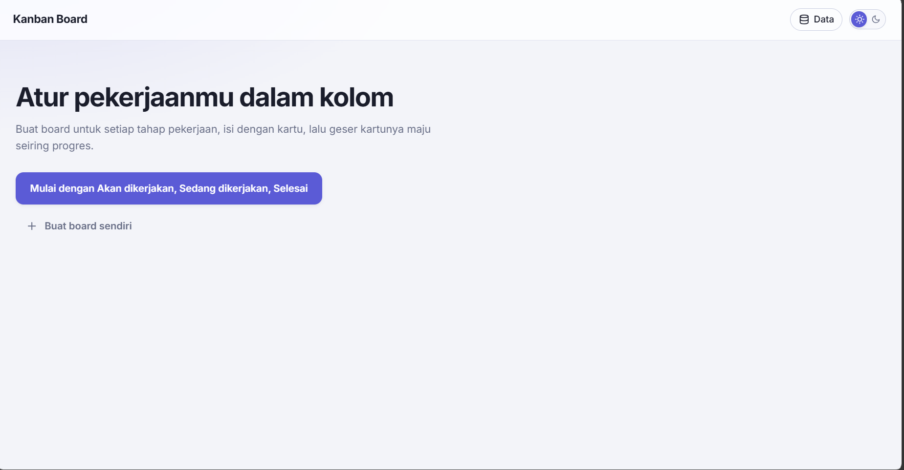
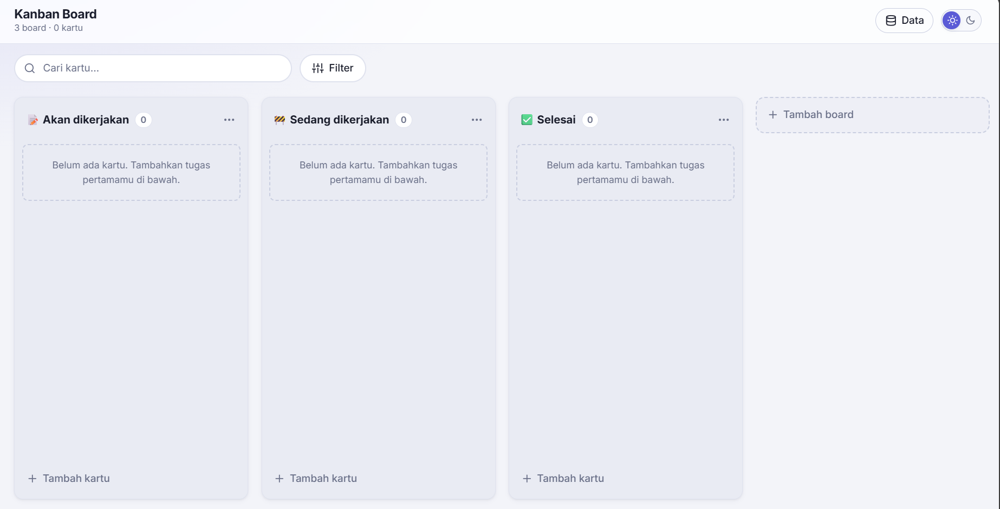
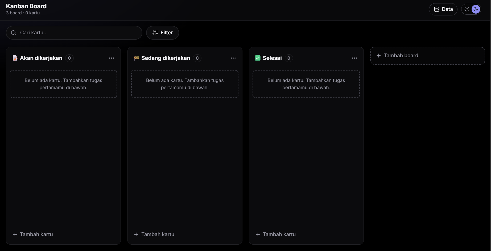

<h1 align="center">Kanban board</h1>

Website **Kanban Board** ini merupakan proyek yang saya kembangkan menggunakan **React.js** untuk memenuhi tugas Ujian Tengah Semester (UTS) perkuliahan. Website ini dibuat untuk memudahkan pengguna dalam mengelola, mengatur, dan memantau tugas atau pekerjaan agar lebih rapi, terstruktur, dan mudah dikelola.

👉 [View Live](https://kanbann-board.netlify.app/)



## Light Mode


## Dark Mode



[](https://kanbann-board.netlify.app/)

## Features ✨

- Drag & drop kartu antar board dan urutan board
- CRUD untuk kartu, label, dan board (kolom)
- Deskripsi kartu, tenggat (due date), dan sub-tugas (checklist)
- Cari kartu (judul, deskripsi, label, checklist) dan filter berdasarkan tenggat / label
- Edit / hapus label (klik label di kartu atau di detail kartu; bisa diterapkan ke semua kartu yang memakainya)
- Backup data: ekspor & impor JSON lewat menu **Data** di navbar (saat belum ada board, hanya **Impor** yang tampil; **Ekspor** muncul setelah ada board)
- Urungkan (undo) setelah menghapus kartu / board / label, mengubah label, atau mengimpor data
- Form tambah (kartu, sub-tugas, board) tetap terbuka setelah menambah, jadi bisa menambah beberapa item berturut-turut. Tekan **Esc** atau **X** untuk menutup
- Dark Mode (tema gelap hitam pekat / AMOLED), dipasang sebelum halaman tampil sehingga tidak berkedip
- Data tersimpan di `localStorage`, dan tab yang lain ikut ter-update bila datanya berubah

## Penggunaan di Perangkat Sentuh 📱

| Perangkat | Tampilan | Memindahkan board | Memindahkan kartu |
| --- | --- | --- | --- |
| Desktop | Kolom berjajar ke samping, daftar kartu menggulir di dalam board | Seret (tahan header board) | Seret, atau tombol ✥ |
| Tablet | Sama seperti desktop; geser ke samping dari area board | Tahan lalu seret **ikon pegangan** (⠿) di kiri judul board | Seret, atau tombol ✥ |
| HP (≤640px, atau landscape berlayar sentuh pendek) | **Mode daftar**: board ditumpuk ke bawah dan bisa dilipat (tombol ⌄); halaman digulir vertikal | Tahan lalu seret **ikon pegangan** (⠿); semua board melipat sementara selama diseret | Tombol ✥ di kartu, atau seret |

- Di layar sentuh, seret board **hanya** lewat ikon pegangan. Mengetuk judul, tombol lipat, atau menu titik tiga tidak akan menggeser board.
- Tombol ✥ di kartu selalu terlihat di layar sentuh (area ketuk 44px). Di perangkat dengan mouse, tombol baru tampil saat kartu di-hover.
- Menggeser dari navbar atau toolbar tidak menggeser halaman ke samping (sentuh, trackpad, maupun mouse). Hanya area board yang menggeser.

## Development setup 🛠

Steps to locally setup development after cloning the project.

### Step 1 - Dependencies

Yang dibutuhkan:

* [node](https://nodejs.org/)

Install Node.js kalau belum punya.

### Step 2 - Install packages

```sh
npm install
```

### Step 3 - Jalankan aplikasi

```sh
npm start
```

Untuk build produksi: `npm run build` (hasil di folder `dist/`), lalu `npm run preview` untuk mencobanya.

Untuk mencoba di HP atau tablet yang satu jaringan, jalankan `npm run dev -- --host` lalu buka alamat IP yang tampil di terminal dari perangkat tersebut.

## Struktur Project 📁

```
src/
├── main.jsx               # entry point
├── App.jsx                # susunan halaman + drag & drop
├── assets/                # gambar, favicon
├── components/
│   ├── layout/            # Navbar, Toolbar (cari/filter), FilterDialog, DataMenu
│   ├── board/             # Board, Card, CardDetails, Label, DatePicker, DueBadge
│   └── ui/                # komponen umum: Modal, Popover, Dropdown, Editable, Tag, Toast, ConfirmDialog
├── hooks/
│   ├── useBoards.js       # state + aksi board/kartu (localStorage, sinkron antar tab) + undo
│   ├── useFilters.js      # state pencarian & filter
│   ├── useTheme.js        # mode terang/gelap
│   ├── useMediaQuery.js   # membaca media query (mode HP, layar sentuh)
│   ├── useViewportWidth.js# lebar area terlihat untuk navbar/toolbar yang menempel
│   ├── useDragGuard.js    # pengaman drag & drop (lihat catatan teknis)
│   └── useLockHorizontalSwipe.js # mencegah halaman bergeser ke samping dari navbar/toolbar
├── constants/             # konstanta (warna label, key localStorage, query mode HP)
├── utils/                 # date.js (tenggat), filters.js (pencarian), backup.js (ekspor/impor)
└── styles/                # design token (index.scss) & layout utama (app.css)
```

Impor memakai alias `@/` (= `src/`), contoh: `import { Modal } from "@/components/ui"`.
Alias ini didefinisikan di `vite.config.js` (untuk build) dan `jsconfig.json` (untuk VS Code).
Setiap komponen punya folder sendiri berisi `.jsx`, `.css`, dan `index.js`.

## Catatan Desain 🎨

- **Responsif untuk semua perangkat**: lebar kolom adaptif, area sentuh ±44px di layar sentuh, dukungan *safe-area* (notch), dan dialog berbentuk *bottom sheet* di HP.
- **Kolom penuh tinggi** (tablet ke atas): semua board setinggi layar, daftar kartu menggulir di dalam board.
- **Mode daftar di HP**: aturannya satu, yaitu `LIST_MODE_QUERY` di `constants/index.js`. Query yang sama **harus** dipakai di `styles/app.css` dan `components/board/Board/Board.css`; kalau diubah, ubah ketiganya.
- **Layar awal saat belum ada board**: tombol cepat "Mulai dengan Akan dikerjakan, Sedang dikerjakan, Selesai" atau "Buat board sendiri".
- **Pill label berwarna** di kartu; semua warna lewat design token di `styles/index.scss`.
- **Efek hover hanya untuk mouse** (`@media (hover: hover) and (pointer: fine)`). Di layar sentuh, terutama iOS, efek hover bisa membuat tombol harus diketuk dua kali.
